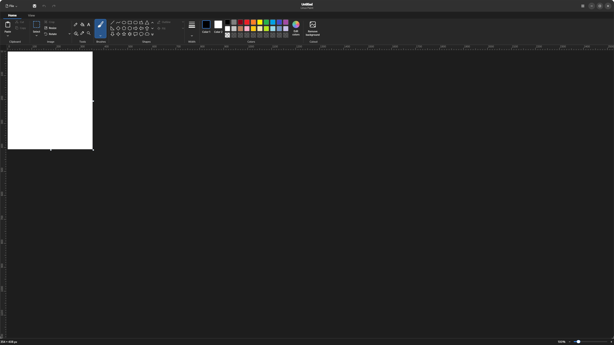
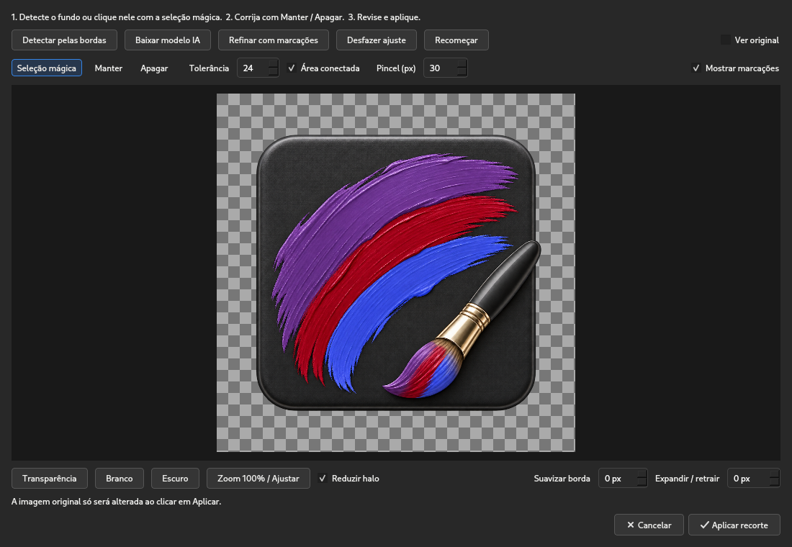

# Linux Paint

A Linux image editor combining the familiarity of classic Paint with a compact ribbon, a unified window header, and a modern desktop appearance. Built with Python and Qt/PySide6. Distribution and support currently target **Linux x86_64 only**.



## Download

Get ready-to-run packages from [Releases](https://github.com/DjaboDev/Linux-Paint/releases/latest).

| Format | Intended use |
|---|---|
| `.tar.gz` | Standalone executable with a local installer; no sudo required |
| `.AppImage` | Portable application with bundled dependencies |
| `.flatpak` | Sandboxed application integrated with the desktop |
| `.deb` | Debian, Ubuntu, and compatible distributions |
| `.rpm` | Fedora and compatible RPM distributions |

The release series restarts at **0.4.0**, incorporating all previous improvements. Windows and macOS packages are no longer distributed or supported in this phase. All five Linux formats come from the same source and standalone executable, pass package startup checks, and include SHA256 checksums.

## Installation

### AppImage

```bash
chmod +x LinuxPaint-0.4.0-linux-x86_64.AppImage
./LinuxPaint-0.4.0-linux-x86_64.AppImage
```

If FUSE is unavailable, add `--appimage-extract-and-run`.

### tar.gz

Extract the archive and launch `LinuxPaint/LinuxPaint`. To add the application to your desktop menu, run `./install.sh` from the extracted folder. This installs into `~/.local` without sudo.

### deb and rpm

```bash
# Debian / Ubuntu:
sudo apt install ./LinuxPaint-0.4.0-linux-x86_64.deb
# Fedora:
sudo dnf install ./LinuxPaint-0.4.0-linux-x86_64.rpm
```

These packages install the application under `/opt/linux-paint`. Avoid keeping both a system package and a tar.gz installation with duplicate desktop launchers.

### Flatpak

```bash
flatpak remote-add --user --if-not-exists flathub https://dl.flathub.org/repo/flathub.flatpakrepo
flatpak install --user ./LinuxPaint-0.4.0-linux-x86_64.flatpak
flatpak run io.github.DjaboDev.LinuxPaint
```

The bundle is distributed by this repository; the application is not listed on Flathub. The Freedesktop 25.08 runtime is downloaded separately. The sandbox allows access to your home directory for opening and saving images, and network access for downloading the optional AI model. Image processing remains local. Flatpak stores its own settings and model cache.

## Features

- Unified header with file actions, save, undo/redo, and window controls.
- Dark mode by default, with a consistent light mode.
- Automatic system language detection: English and Portuguese interfaces; other languages fall back to English. Native desktop dialogs follow the desktop language.
- Selection, cropping, resizing, rotation, pencil, brushes, eraser, text, shapes, and colors.
- Round, square, and airbrush tools with distinct previews.
- Pencil, brush, eraser, and shape widths from 1 to 200 pixels; `[` / `]` adjust width, while `Ctrl +` / `Ctrl -` control zoom.
- Edge hardness for pencil strokes and geometric shapes, with reversible previews that preserve existing pixels.
- Rulers, grid, zoom, visible canvas resizing feedback, and undo/redo.
- Native Linux file chooser starting in the current user's home directory.
- Real PNG transparency and a warning before exporting to an opaque format.

## Background removal



Open an image and click **Remove background** to the right of the ribbon's color controls.

1. For simple backgrounds, use **Detect from edges** or **Magic selection** and click the background. Tolerance controls color variation; **Connected region** avoids removing isolated regions of the same color.
2. For photographs, download the optional model and use **Detect with AI**. BiRefNet General Lite is downloaded once, verified, and cached locally. Images are never uploaded to a processing service.
3. Correct the mask with **Keep** and **Remove**. **Refine with markings** uses GrabCut to improve the separation. Adjustments can be undone or reset.
4. Review transparency, white, and dark previews. Adjust feathering, expansion/contraction, and halo reduction. Use the wheel to zoom and the middle mouse button to pan.
5. Click **Apply cutout**, then save as **PNG**. The editor keeps the original until application; `Ctrl+Z` restores it afterward.

Automatic detection is a starting point. Hair, transparent objects, shadows, objects touching the image boundary, and similar foreground/background colors can require manual corrections. Manual markings take priority over the automatic mask. Feathering never makes originally transparent pixels opaque.

Processing runs in a background task. Cancelling preserves the source image; an inference already in progress may take a few seconds to finish. The optional model is approximately 220 MB and requires an internet connection for its first download. Color-based selection and GrabCut work without it.

## Run from source

Use Python 3.12:

```bash
python3.12 -m venv .venv
source .venv/bin/activate
python -m pip install -r requirements.txt
python paint.py
```

`python install_linux.py` installs a launcher using the active virtual environment. Keep that environment in its original location. The installer preserves the legacy `classic-paint` command and migrates the GNOME favorite when applicable.

## Tests and packaging

```bash
python -m unittest discover -v
python smoke.py
python check_ui.py
python build.py
python linux_packages.py
```

Regression tests cover drawing, stroke width, hardness, colors, themes, masks, transparency, manual corrections, cancellation, and undo/redo. `check_ui.py` renders the interface at QHD resolution. Real AI inference is checked separately; routine tests do not download model weights.

The GitHub workflow builds on Ubuntu 22.04 x86_64. `build.py` produces the standalone executable, tar.gz, and AppImage. `linux_packages.py` produces deb, rpm, and Flatpak packages and checks their executable payloads. Packaging needs `dpkg-deb`, `rpmbuild`, `rpm2cpio`, `cpio`, and Flatpak with the Freedesktop 25.08 SDK/runtime installed. The workflow publishes the five formats together after successful checks.

| File | Responsibility |
|---|---|
| `classic_paint/app.py` | Editor, canvas, history, and input |
| `classic_paint/modern_ui.py` | Symbolic ribbon and desktop identity |
| `classic_paint/modern_widgets.py` | Modern font previews and text controls |
| `classic_paint/i18n.py` | System-language interface translations |
| `classic_paint/brushes.py` | Stroke hardness and shape feathering |
| `classic_paint/cutout.py` | Masks, color selection, GrabCut, and AI inference |
| `classic_paint/cutout_dialog.py` | Cutout preview and correction tools |
| `build.py` / `linux_packages.py` | Linux executable, package checks, and hashes |
| `install_linux.py` / `linux/install-packaged.sh` | Source and tar.gz desktop integration |

## Credits and license

Fork development: [DjaboDev/Linux-Paint](https://github.com/DjaboDev/Linux-Paint). Original project: [blankresearch/ClassicPaint](https://github.com/blankresearch/ClassicPaint).

Project code is licensed under MIT. The current icon and symbolic ribbon were created for Linux Paint. Inherited legacy resources may carry separate terms; see [THIRD_PARTY_NOTICES.md](THIRD_PARTY_NOTICES.md). This project is independent of Microsoft.

Local cutout processing uses [OpenCV/GrabCut](https://docs.opencv.org/4.x/d8/d83/tutorial_py_grabcut.html), [BiRefNet](https://github.com/ZhengPeng7/BiRefNet), and [ONNX Runtime](https://onnxruntime.ai/). Model sources and configuration are documented in the third-party notices.
