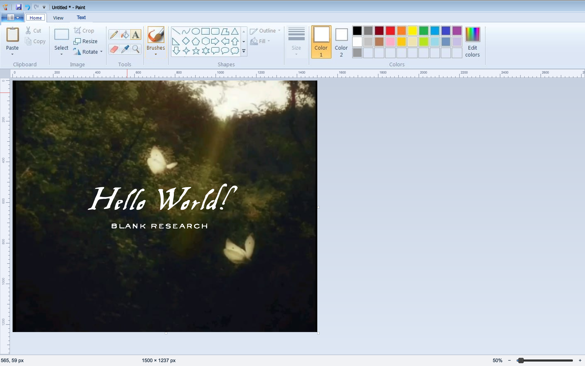
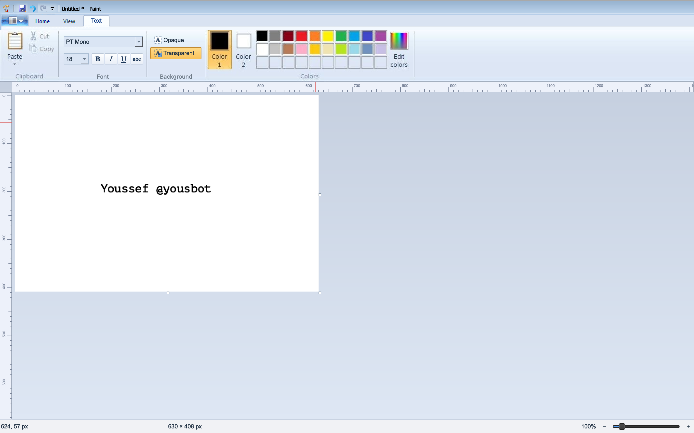

# Classic Paint

A Python clone of classic Microsoft Paint, recreating its familiar interface and drawing tools for macOS and Linux. Tested on both platforms.

## Features

- Classic Paint interface with a ribbon toolbar and embedded icons.
- Pencil, brushes, eraser, flood fill, color picker, text, and shapes.
- Selection, moving, cropping, resizing, and rotation.
- Clipboard support, undo and redo, and keyboard shortcuts.
- Image loading, saving, and printing.

## Download

Download the latest stable version from the [Releases page](https://github.com/blankresearch/ClassicPaint/releases/latest).

| Platform | Download |
| --- | --- |
| macOS — Intel | [Download DMG](https://github.com/blankresearch/ClassicPaint/releases/latest/download/ClassicPaint-darwin-x86_64.dmg) |
| Linux — Intel/AMD 64-bit | [Download archive](https://github.com/blankresearch/ClassicPaint/releases/latest/download/ClassicPaint-linux-x86_64.tar.gz) |

[View all releases](https://github.com/blankresearch/ClassicPaint/releases)

On macOS, open the DMG and drag **ClassicPaint.app** into **Applications**.

On Linux, extract the archive and run:

```bash
tar -xzf ClassicPaint-linux-x86_64.tar.gz
./ClassicPaint

## Run from source

Use Python 3.11 and install the project dependencies:

```bash
python3.11 -m venv .venv
source .venv/bin/activate
python -m pip install -r requirements.txt
python paint.py
```

Open an image directly:

```bash
python paint.py /path/to/image.png
```

## Build standalone packages

Run the build script on the target operating system:

```bash
python build.py
```

Packages are written to `release/`: a `.dmg` on macOS and a `.tar.gz` on Linux. Build separately for each operating system and processor architecture.

## Project structure

| Path | Purpose |
| --- | --- |
| `paint.py` | Application launcher |
| `classic_paint/app.py` | Interface, drawing tools, and embedded artwork |
| `classic_paint/__init__.py` | Package metadata |
| `classic_paint/__main__.py` | Module entry point |
| `requirements.txt` | Application and packaging dependencies |
| `build.py` | Standalone package builder |
| `smoke.py` | Headless window initialization check |
| `.github/workflows/build.yml` | Automated platform builds |

## Compatibility

Tested on macOS and Linux. Compatibility depends on the operating system version, processor architecture, and Qt runtime requirements; testing does not establish support for every version or distribution.

## Attribution

An independent project, unaffiliated with Microsoft. Microsoft Paint and its original artwork belong to their respective owners. The supplied source identifies the Python code as MIT licensed and the embedded original artwork as separately licensed; the code license does not grant rights to that artwork.

Made by [Youssef](https://yousbot.com) with ❤️